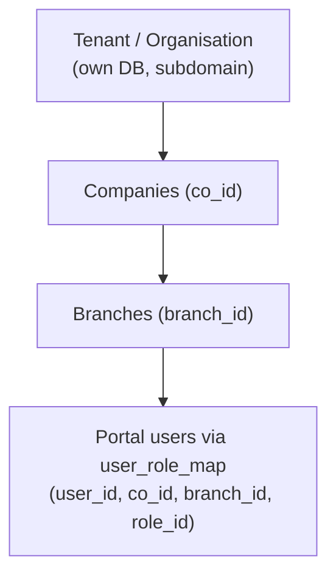

# VoWERP3 Frontend - Developer Guide for Claude

## Project Overview

VoWERP3 UI is a **multi-tenant ERP frontend** for procurement, inventory, sales, and jute/yarn management.

**Current Repo:** `vowerp3ui` | **Backend:** `vowerp3be` (FastAPI/Python, sibling repo at `../vowerp3be`)

---

## File-Path Registry

Everything discoverable from one place. Paths are repo-relative; the backend repo is `../vowerp3be`.

### Documentation map

| Path | Purpose |
|------|---------|
| `CLAUDE.md` | This guide |
| `docs/claude/TEAM.md` | Agent team roster: roles → agent files → when to engage; skills table; team norms |
| `docs/claude/roles-and-users.md` | Users/roles/permissions across all three dashboards |
| `docs/claude/transaction-patterns.md` | Transaction page architecture, hooks, approval workflow patterns |
| `docs/claude/code-examples.md` | TypeScript, Zod, component, styling examples + pitfalls |
| `docs/claude/api-patterns.md` | API client, service layer, auth flows |
| `docs/claude/testing-guide.md` | Vitest, Storybook, JSDoc standards |
| `docs/claude/modules/_TEMPLATE.md` | Canonical structure for module guides |
| `docs/claude/modules/{module}/` | Per-module knowledge docs (page catalogs, backend maps, approval flows) |
| `AGENTS_GUIDE.md` | Comprehensive developer guide |
| `instructions.md` | ApprovalActionsBar contract (status IDs, button visibility) |
| `docs/hrms/`, `docs/GST_PROCUREMENT_FRONTEND.md` | Domain docs |
| `docs/yarn-quality/` | Yarn-quality feature docs (historical) |
| `.github/WORKSPACE-INSTRUCTIONS.md` | Active vs legacy repos |

### Agents & Skills (`.claude/agents/`, `.claude/skills/`)

Both are auto-listed each session. Module-guide agent full bodies live HERE; `../vowerp3be/.claude/agents/` has pointer copies. Skill canonical bodies live in `../vowerp3be/.claude/skills/`.

### Key source files

| Path | Purpose |
|------|---------|
| `src/utils/api.ts` | All route constants (`apiRoutes`, `apiRoutesconsole`, `apiRoutesPortalMasters`) |
| `src/utils/apiClient2.ts` | `fetchWithCookie` — the only way to call APIs |
| `src/middleware.ts` | Session verification + portal per-route permission check |
| `src/components/ui/transaction/ApprovalActionsBar.tsx` | Shared approval bar |
| `src/components/ui/SearchableSelect.tsx` | Canonical searchable dropdown — the ONLY way to render a dropdown |
| `src/components/dashboard/sidebarContext.tsx` | Portal sidebar context (companies, branches, menus, permissions) |
| `src/utils/portalPermissions.ts` | Portal action helpers |
| `src/styles/tokens.ts` | Theme tokens (never hardcode colors) |

---

## Tenancy & Environments

The system is **multi-tenant**: each tenant (organisation) has its own backend database, and within
each tenant there are **companies (`co_id`)** and **branches (`branch_id`)**.



- **`dev3` is the QA/dev tenant** — the default target for all new work and creation.
- Production tenants may have schema drift vs dev3 (extra tables/columns). Before developing against
  them, run the `tenant-schema-check` skill and **ask the user** before syncing anything into dev3.
- **Company & branch sidebar (CRITICAL for portal work):** every `dashboardportal` page must honor
  the company/branch selection from `SidebarContext` — the selected `co_id`/`branch_id` flow into
  every API call and default the form headers. Never ignore the sidebar selection. Master pages
  need at minimum `co_id`; transactional pages `co_id` + `branch_id`.
- Full roles/users/permissions model: `docs/claude/roles-and-users.md`.

---

## Three-Dashboard Architecture (MOST IMPORTANT)

The app has **three completely separate dashboards** for three user personas. Each has its own layout, sidebar, menus, API endpoints, and permission model. **Identify which dashboard you're working in before writing any code.**

### Dashboard 1: VOW Admin (Control Desk) -- `/dashboardctrldesk`

**Purpose:** high-level control desk used by the **VOW team itself** (vendor-internal) to manage
organizations/tenants, system-wide menus, and control-desk roles/users. Tenants never see it.

| Aspect | Details |
|--------|---------|
| **Route prefix** | `/dashboardctrldesk/` |
| **Layout** | `src/app/dashboardctrldesk/layout.tsx` |
| **Sidebar** | `SidebarConsole` -> `sidebarConsole.tsx` |
| **Menu hook** | `use-org-ctrldesk.tsx` -> fetches from `MENU_CTRLDESK` |
| **Login endpoint** | `SUPERADMINLOGINCONSOLE` -> `/authRoutes/loginconsole` |
| **API prefix** | `/ctrldskAdmin/` |
| **Backend DB** | `vowconsole3` (no org filter) |
| **Subdomain** | `admin` (hardcoded detection) |
| **Pages** | orgSetup, roleManagementAdmin, userManagementAdmin, menuManagement, orgModuleMap |

### Dashboard 2: Tenant Admin -- `/dashboardadmin`

**Purpose:** where **each tenant** sets its own configuration — companies, branches, departments,
users, roles, approval hierarchy, pay schemes.

| Aspect | Details |
|--------|---------|
| **Route prefix** | `/dashboardadmin/` |
| **Layout** | `src/app/dashboardadmin/layout.tsx` |
| **Sidebar** | `SidebarConsole` -> `sidebarCompanyConsole.tsx` |
| **Menu hook** | `use-org-console_menu.tsx` -> fetches from `GET_TENANT_ADMIN_MENU_ROLE` |
| **Login endpoint** | `USERLOGINCONSOLE` -> `/authRoutes/login` |
| **API prefix** | `/companyAdmin/` |
| **Backend DB** | `vowconsole3` (scoped by `con_org_id`) |
| **Subdomain** | Tenant subdomain (e.g., `dev3`, `sls`) |
| **Pages** | companyManagement, branchManagement, deptManagement, roleManagement, userManagement, approvalHierarchy |

### Dashboard 3: Tenant Portal -- `/dashboardportal`

**Purpose:** day-to-day business operations (procurement, masters, inventory, sales, jute, HRMS,
accounting) for the tenant's operational users, scoped by the company/branch sidebar selection.

| Aspect | Details |
|--------|---------|
| **Route prefix** | `/dashboardportal/` |
| **Layout** | `src/app/dashboardportal/layout.tsx` |
| **Sidebar** | `Sidebar` -> `sidebar.tsx` + `SidebarProvider` + `PortalPermissionBoundary` |
| **Menu hook** | `SidebarContext` (context-based, with localStorage caching) |
| **Login endpoint** | `USERLOGINCONSOLE` -> `/authRoutes/login` |
| **API prefix** | `/admin/PortalData/` (admin) + business routes (`/itemMaster/`, `/procurementIndent/`, etc.) |
| **Backend DB** | Tenant-specific DB (e.g., `dev3`, `sls`) |
| **Permission model** | Action-level: view(1), print(2), create(3), edit(4) via `portal_permission_token` |
| **State management** | `SidebarProvider` context (companies, branches, menus, permissions) |
| **Pages** | masters/, procurement/, inventory/, jutePurchase/, juteProduction/ |

### Permission Differences

| Dashboard | Permission Model | Middleware Check |
|-----------|-----------------|-----------------|
| Control Desk | Role-based (via menu structure) | Access token only |
| Tenant Admin | Role-based (via menu structure) | Access token only |
| Portal | **Action-level** (view/print/create/edit per menu) | Access token + `portal_permission_token` + per-route permission check |

Portal permission check is in `src/middleware.ts`.

### Choosing Where to Add New Pages

| If the page is for... | Put it under... | API prefix |
|----------------------|----------------|------------|
| Managing organizations, system menus | `dashboardctrldesk/` | `/ctrldskAdmin/` |
| Managing companies, branches, departments, tenant users | `dashboardadmin/` | `/companyAdmin/` |
| Managing portal users, roles, menus, approvals | `dashboardportal/` (uses `/admin/PortalData/`) | `/admin/PortalData/` |
| Business operations (procurement, masters, inventory) | `dashboardportal/{module}/` | `/{moduleName}/` |

> For login flow details and auth flows, see `docs/claude/api-patterns.md`.

---

## Critical Rules (MANDATORY)

### TypeScript
- **NEVER use `any`** -- use `unknown` with type guards
- Always define interfaces for component props
- Use type inference where possible
- Avoid circular dependencies -- use single type definition files per module

### Zod Validation
- **Zod is REQUIRED for ALL forms and API inputs**
- Define schema -> infer type with `z.infer<>` -> use with `zodResolver` in React Hook Form
- Single source of truth for types and validation

### Component Organization
- **Shared components:** `src/components/ui/` or `src/components/{feature}/` -- require JSDoc, prop interfaces
- **Page-specific components:** `_components/` subfolder within page directory
- **Smart (container) components:** `page.tsx` handles state, data, logic
- **Dumb (presentational) components:** `_components/*.tsx` renders from props only

### Dropdowns (MANDATORY -- searchable, never selection-only)

**Every dropdown in the app must be searchable with type-ahead autofill.** A user must always be
able to click a dropdown and start typing to filter it. Selection-only dropdowns -- where the user
can only scroll a list -- are not permitted anywhere, in any of the three dashboards.

- **Use `SearchableSelect` / `SearchableMultiSelect`** from `@/components/ui/SearchableSelect`.
- **Or `SearchableOptionSelect`** from `@/components/ui/SearchableOptionSelect` -- a thin adapter over
  the above for the common case where form state holds a plain `string`/`number` id and the options
  were previously `<MenuItem>` children. It owns the option-object <-> id mapping so call sites do
  not repeat `find(...) ?? null`. Empty selection is `""`, exactly as MUI's `Select` used.
- **Never render a raw MUI `<Select>` + `<MenuItem>`**, a raw `<TextField select>`, a native
  `<select>`, or the shadcn `<Select>` primitive directly in a page or feature component.
  (`src/components/ui/select.tsx` stays as an internal primitive; consume it only through a shared
  wrapper.)
- **No exceptions for short lists.** Two-option dropdowns (Active/Inactive, Yes/No, Dr/Cr) are
  searchable too. The point is that behaviour is uniform -- a user never has to guess which
  dropdowns accept typing.
- **Never disable typing** on an `Autocomplete` (no `readOnly` on the input to force picking).
  To make a field non-editable, use `disabled`, which is the mode-aware pattern.
- **Variants:** `variant="outlined"` for normal labelled form fields (the drop-in for
  `FormControl` + `InputLabel` + `Select`); `variant="bare"` inside DataGrid cells and line-item
  tables, where the cell already draws the frame.
- **Value shape:** the component deals in option objects; map option object <-> id at the component
  boundary so form state keeps storing the primitive id. Pair `getOptionLabel` with
  `isOptionEqualToValue` whenever options are objects.
- **Large lists are the reason this exists.** Item, party, and ledger dropdowns run to thousands of
  rows; `SearchableSelect` caps rendered options and filters by typed text, so typing is both the
  usability answer and the performance answer.

> For a before/after conversion example, see `docs/claude/code-examples.md`.

### Branch selector (follow the sidebar scope — NORM for all pages)

- A page's branch filter must offer only the branches the user has in scope in the **sidebar**
  (their selected branches; all company branches only when the sidebar has no selection).
  Report pages get this from `useReportBranches` (`src/components/reports/useReportBranches.ts`),
  which already applies the scoping.
- **Render the branch picker only when more than one branch is in scope.** With a single branch,
  auto-select it and show the branch name as plain text — never a one-option dropdown.
- This is a standing norm for all new pages and retrofits, in every dashboard.

### Printing (MANDATORY — no browser header / footer on any printout)

Every print path (`openStyledPrintWindow` in `src/utils/printUtils.ts`, `buildPrintHtml` in
`src/components/reports/printReport.ts`, the juteSQC `printReport.ts`, and any page-level
`@media print` stylesheet) must print **without the browser's default header and footer**
(date, page title, URL, page numbers that Chrome / Edge add in the page margins). The rule
is `@page { size: A4; margin: 0; }` (orientation as needed) with the real margins on
`body { padding: 15mm }` (or the page's own value) — a zero page margin is what makes the
browser omit its marks; it is not optional per page. Owner rule, 2026-10-12. When a page
needs a PDF without any browser involvement, add a server-side reportlab endpoint instead
of relying on "Save as PDF".

### Styling (Three Layers)
- **Tailwind CSS** for layout and spacing
- **MUI components** for complex interactions (DataGrid, Autocomplete, Dialog)
- **Theme tokens** (`src/styles/tokens.ts`) for colors -- **NEVER hardcode colors**
- Theme files: `tokens.ts`, `theme.ts`, `AppThemeProvider.tsx`, `tailwind.config.ts`

> For code examples of all the above, see `docs/claude/code-examples.md`.

---

## Backend Integration Essentials

### Status IDs (MUST match backend exactly)

| ID | Status | ID | Status |
|----|--------|----|--------|
| 21 | Draft | 3 | Approved |
| 1 | Open | 4 | Rejected |
| 20 | Pending Approval | 5 | Closed |
| | | 6 | Cancelled |

### API Response Format
```typescript
{ "data": [...], "master": [...] } // master is optional
```

### Cookies
- `access_token` -- JWT auth token (all dashboards)
- `portal_permission_token` -- permission data (Portal only)
- `subdomain` -- tenant identifier

### API Client
- Use `fetchWithCookie` from `src/utils/apiClient2.ts` (never call APIs directly in components)
- Routes defined in `src/utils/api.ts` (three route objects by dashboard)
- Service layer in `src/utils/{feature}Service.ts`

> For full API patterns, service layer examples, and auth flows, see `docs/claude/api-patterns.md`.

---

## Transaction Pages (Approval Workflows)

For documents like Indent, PO, GRN, Invoice -- follow the standardized architecture.

> For complete patterns, hook examples, and step-by-step guide, see `docs/claude/transaction-patterns.md`.

---

## Best Practices

### DO
1. Validate with Zod -- all forms and API inputs
2. Strict TypeScript -- no `any`, use proper types
3. Mode-aware rendering -- check `mode !== "view"` before enabling edits
4. Immutable defaults -- `Object.freeze()` on empty arrays/objects
5. Separate concerns -- types, constants, factories in own files

### DON'T
1. Never hardcode colors -- use theme tokens
2. Never use `any` types -- use `unknown` with type guards
3. Never call APIs directly in components -- use service functions
4. Never create circular dependencies -- single type definition files
5. Never commit `console.log`
6. Never use browser globals in server components
7. Never skip Zod validation
8. Never mutate frozen objects
9. Never hardcode status IDs -- use constants
10. Never skip tests for complex logic
11. Never ship a selection-only dropdown -- always `SearchableSelect`/`SearchableMultiSelect`, never a raw MUI `Select`, `TextField select`, or native `<select>`

### React Hook Declaration Order
Block-scoped `useMemo`/`useCallback` are NOT hoisted. Always declare dependencies before dependents.

> For pitfall examples with code, see `docs/claude/code-examples.md`.

---

## Development Commands

Standard `pnpm` scripts -- see `package.json`.

> For testing examples and Storybook usage, see `docs/claude/testing-guide.md`.

---

## Common Examples in Codebase
- **List Pages:** `src/app/dashboardportal/masters/itemMaster/page.tsx`
- **Transaction Pages:** `src/app/dashboardportal/procurement/indent/createIndent/`
- **Shared Components:** `src/components/ui/`

---

## Knowledge-Graph Index (secondary — may be stale)

Machine-generated indices for both repos live in `../vowerp3be/graphify-out/` (`bridge.json` with
FE-const → BE-endpoint matches, `index_fe.json`, `index_be.json`, `GRAPH_REPORT.md`).

**Status: the graphify CLI is currently non-operational and the artifacts may be stale.** The
module guides (`docs/claude/modules/` + the `module-*` agents) and the actual source files are the
PRIMARY reference — consult the graph only as a quick cross-check, and verify every hit against the
backend router source before relying on it. Regenerate (when fixed) from the backend repo with
`python tools/bridge_extractor.py` / `tools/index_extractor_fe.py` / `tools/index_extractor_be.py`.
