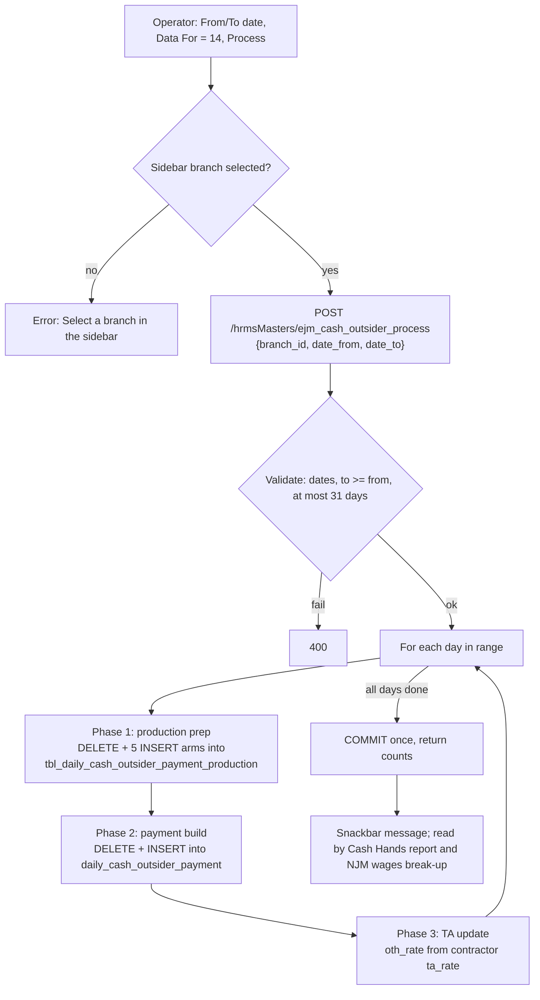

# EJM Cash/Outsider Daily Payment Preparation

Action **14** on the EJM Wages Process screen. Builds the daily cash payment of
T-numbered outsider workers at EJM (sls branch 29) from approved attendance,
spinning/winding production and rate masters.

Legacy origin: `Loan_adv_model.php::updateholidayaData` with `holget == 14`
(payment build) plus `oattprdprocess` (production prep).

| Layer | Location |
|-------|----------|
| Page | `src/app/dashboardportal/hrms/EjmWagesProcess/page.tsx` (`ACTION_CASH_OUTSIDER = "14"`) |
| Route constant | `apiRoutesPortalMasters.EJM_CASH_OUTSIDER_PROCESS` in `src/utils/api.ts` |
| Endpoint | `POST /api/hrmsMasters/ejm_cash_outsider_process` |
| Backend | `../vowerp3be/src/hrms/ejmWagesData.py` → `ejm_cash_outsider_process()` |
| DB | Tenant DB (`get_tenant_db`), e.g. `sls` |

---

## Flow at a glance



The run uses a single transaction. Any error rolls back every day in the run.
Each day is deleted and rebuilt, so re-running is safe.

---

## Step 1: Operator input (frontend)

1. Open **HRMS → EJM Wages Process**.
2. Pick **From Date** and **To Date**. Pay scheme is **not needed**: the page
   fills a placeholder so schema validation passes, and `pay_scheme_id` is never sent.
3. Pick **Data For = "EJM Cash/Outsider Daily Payment prepartion"** (value `14`).
4. Click **Process**. `run("action")` runs these checks:
   - `submitSchema.safeParse` (Zod) validates the dates.
   - `branchId == null` → error *"Select a branch in the sidebar before processing"*.
5. The request is sent with `fetchWithCookie`:

```json
POST /api/hrmsMasters/ejm_cash_outsider_process
{ "branch_id": 29, "date_from": "2026-09-01", "date_to": "2026-09-13" }
```

6. On success the page shows `data.data.message` as a success snackbar. No grid is rendered.

## Step 2: Backend validation

| Check | Response |
|-------|----------|
| `branch_id` or `date_from` missing | 400 `branch_id and date_from are required` |
| `branch_id` is not 29 (EJM FACTORY) | 400 `...runs only for branch 29 (EJM FACTORY)`. The page blocks this before calling the API. |
| `date_to` omitted | defaults to `date_from` |
| Unparseable date | 400 `Invalid date` |
| `date_to < date_from` | 400 `To date is before From date` |
| Range ≥ 31 days | 400 `At most 31 days per run` |

`user_id` comes from the JWT (`get_current_user_with_refresh`) and is written to `updated_by`.

## Step 3: Phase 1, production prep (per day)

Clear the day first:

```sql
DELETE FROM tbl_daily_cash_outsider_payment_production
WHERE prod_date = :d AND branch_id = :branch_id;
```

Then five INSERT arms run in order. Every arm feeds the same shared head
(`_CASH_INSERT_HEAD`):

```sql
INSERT INTO tbl_daily_cash_outsider_payment_production
    (branch_id, eb_id, dept_id, desig_id, production, is_active, rate_type,
     prod_date, prod_shift, targt_production, prod_amount, prod_rate, updated_by)
SELECT :branch_id, t.eb_id, t.dept_id, t.desig_id, ROUND(t.prod,3), 1, t.ratetype,
       :d, t.shift, ROUND(t.std,3),
       ROUND((CASE WHEN t.ratetype=1 THEN t.rate_hi ELSE t.rate_lo END) / 8
             * (t.whrs + CASE WHEN t.shift='C' AND t.whrs=7.5 THEN 0.5 ELSE 0 END), 2),
       CASE WHEN t.ratetype=1 THEN t.rate_hi ELSE t.rate_lo END,
       :user_id
FROM ( <arm query> ) t
```

- `ratetype = 1` means production met the standard, so the worker gets `rate_hi`
  (`rate_on_production`). Otherwise the worker gets `rate_lo` (`rate`).
- A C-shift with exactly 7.5 working hours is paid as 8 hours.

### Who is covered (every arm)

This is the common attendance base, `_cash_att_sql`:

```sql
FROM daily_attendance da
JOIN spell_mst sp               ON sp.spell_id = da.spell_id
JOIN hrms_ed_official_details od ON od.eb_id = da.eb_id AND od.active = 1
WHERE da.attendance_date = :d
  AND da.is_active = 1 AND da.status_id = '<ATTENDANCE_APPROVED>'   -- ATT_LIVE_SQL
  AND SUBSTRING(TRIM(od.emp_code),1,1) = 'T'                          -- T-numbered outsiders
  AND da.attendance_type IN ('R','O')                                 -- regular / overtime
  AND da.branch_id = :branch_id
```

- Working hours are `da.working_hours - COALESCE(da.idle_hours, 0)`.
- The shift is `LEFT(spell_mst.spell_code, 1)`.

### Rate lookup per arm

A worker is included in an arm only when their **worked designation** has a rate
row for that arm in `tbl_outsider_occupation_rate`. The contractor's own row is
used first. If there is none, the row with `contac_id IS NULL` is used.

```sql
JOIN tbl_outsider_occupation_rate r ON r.occupation_rate_id = (
    SELECT r2.occupation_rate_id FROM tbl_outsider_occupation_rate r2
    WHERE r2.is_active = 1
      AND r2.desig_id  = da.worked_designation_id
      AND r2.prod_calc IN (:arm_codes)
      AND (r2.contac_id = od.contractor_id OR r2.contac_id IS NULL)
    ORDER BY (r2.contac_id IS NULL), r2.occupation_rate_id DESC
    LIMIT 1)
```

### The five arms

Yarn-count bands for the 8-hour standard come from `jute_yarn_mst.jute_yarn_count`
(joined per `item_id`).

| Band | Spinning std (`CASH_SPG_STD`) | Winding std (`CASH_WND_STD`) |
|------|-------------------------------|------------------------------|
| count ≤ 12.99 | 261 | 277 |
| 13 – 15.99 | 363 | 330 |
| ≥ 16 | 394 | 362 |

| # | Arm | `prod_calc` | Production source | Standard | Met test |
|---|-----|-------------|-------------------|----------|----------|
| 1 | **helpers** | 4 | `daily_ebmc_attendance` (frames the helper was assigned to) → `daily_doff_tbl.net_weight` for that frame and spell | Band std, weighted by production, × `spell_mst.working_hours / 8` | Σ prod ≥ Σ std |
| 2 | **spinner** | 5 | Worker's own eb-stamped `daily_doff_tbl` rows | Same per-frame spell std | Σ prod ≥ Σ std |
| 3 | **winding** | 6 | `jute_prod_winding_doff.production_qty` (per eb + spell) | Winding band std × attended hours / 8 | Σ prod ≥ Σ std |
| 4 | **timerate** | 1, 2, 3 | none | none | always met, paid at `rate_on_production` |
| 5 | **t2151** | none (hardcoded) | none | none | emp_code `T2151`, contractor 10, flat 520 |

Notes:
- **Spinner** rates are per contractor, not per designation, because doffs carry
  no designation: `MAX(rate_on_production) / MAX(rate)` from `prod_calc` 5 rows,
  grouped by `contac_id`. Attendance is LEFT-joined for hours, dept and desig.
  If there is no attendance row, the shift defaults to `'G'` and hours to 0.
- The doff filter is `doff_date = :d AND (active = 1 OR active IS NULL) AND branch_id = :branch_id`.
- The winding filter is `tran_date = :d AND active = 1 AND branch_id = :branch_id`.
- If an item has no `jute_yarn_mst` row, its count is NULL and it drops out of the standard.

## Step 4: Phase 2, payment build (per day)

This phase reads the production rows written in Phase 1.

```sql
DELETE FROM daily_cash_outsider_payment WHERE pay_date = :d AND branch_id = :branch_id;
```

Then one INSERT (`_CASH_PAYMENT_INSERT`) runs.

**Who is paid:** the same `'T'` / `R,O` / approved-attendance filter as Phase 1,
plus a mandatory join:

```sql
JOIN tbl_worker_sublocation_table ws
  ON ws.eb_id = da.eb_id AND ws.daily_others_pay_duration = 'T'
```

> A worker missing from `tbl_worker_sublocation_table` (for example a new hire)
> gets **no payment row**, even with attendance and production.

**Grouping:** one row per `eb_id, dept_id, desig_id, shift, cont_id, subloca_id`.
The C-shift 7.5 → 8 rule is applied per attendance row before summing.

**Rate priority** is `COALESCE(day_rate, prod_rate, occ_rate, std_rate, 0)`:

| Priority | Name | Source | Match |
|----------|------|--------|-------|
| 1 | `day_rate` | `outsider_rate_approve.rate_approve` | `eb_id`, `app_date = :d`, shift matches or blank (exact shift preferred) |
| 2 | `prod_rate` | `tbl_daily_cash_outsider_payment_production.prod_rate` (Phase 1) | `eb_id`, `prod_date`, `branch_id`, `prod_shift`, `desig_id` |
| 3 | `occ_rate` | `tbl_outsider_occupation_rate.rate` | `desig_id`; row applies when `IFNULL(prod_calc,0)=0` **or** (`rate > 0` and `contac_id` = worker's contractor); latest id wins |
| 4 | `std_rate` | `outsider_rate_approve.rate_approve` | `eb_id`, latest `app_date <= :d` (standing rate; replaces legacy `worker_master.cash_rate`) |

Inserted columns:

```text
eb_id, pay_date=:d, shift, dept_id, desig_id, subloca_id,
working_hours = ROUND(whrs,3), rate, oth_rate = 0,
amount = ROUND(rate / 8 * whrs, 0), branch_id, cont_id, is_active = 1
```

## Step 5: Phase 3, travel allowance (per day)

```sql
UPDATE daily_cash_outsider_payment p
JOIN tbl_outsider_occupation_rate r
  ON r.occupation_rate_id = (
     SELECT r2.occupation_rate_id FROM tbl_outsider_occupation_rate r2
     WHERE r2.is_active = 1
       AND r2.desig_id = p.desig_id
       AND r2.contac_id = p.cont_id
       AND r2.ta_rate > 0
     ORDER BY r2.occupation_rate_id DESC
     LIMIT 1)
SET p.oth_rate = ROUND(p.working_hours / 8 * r.ta_rate, 0),
    p.amount   = p.amount + ROUND(p.working_hours / 8 * r.ta_rate, 0)
WHERE p.pay_date = :d AND p.branch_id = :branch_id;
```

**Amount includes TA:** `amount = ROUND(rate / 8 × hours) + ROUND(ta_rate / 8 × hours)`.
For example, rate 390 with TA 30 for 8 hours gives oth_rate 30 and amount 420.

TA is looked up per **designation and contractor** (exact match on both, the
latest row wins). A row with no contractor (`contac_id` NULL) gives no TA. To
give TA to a designation for a contractor, add or edit the
`tbl_outsider_occupation_rate` row for that `desig_id` + `contac_id` with
`ta_rate > 0`.

## Step 6: Commit and response

When all days finish, `db.commit()` runs once:

```json
{ "data": {
    "message": "Cash/Outsider daily payment built — 812 production rows (helpers 120, spinner 300, winding 210, timerate 180, t2151 2), 940 payment rows",
    "rows": 812, "payment_rows": 940,
    "arms": { "helpers": 120, "spinner": 300, "winding": 210, "timerate": 180, "t2151": 2 }
} }
```

Any exception triggers a rollback and a 500 with the error text.

---

## Tables used

| Table | Role | R/W |
|-------|------|-----|
| `daily_attendance` | Approved attendance: hours, idle hours, worked dept/desig, spell, type | R |
| `spell_mst` | Shift letter (`spell_code`), spell `working_hours` | R |
| `hrms_ed_official_details` | `emp_code` (T-prefix), `contractor_id` | R |
| `daily_ebmc_attendance` | Helper → machine (frame) assignment | R |
| `daily_doff_tbl` | Spinning doffs: `mc_id`, `spell`, `eb_id`, `item_id`, `net_weight` | R |
| `jute_prod_winding_doff` | Winding production per eb and spell | R |
| `jute_yarn_mst` | Yarn count per `item_id`, used for the standard band | R |
| `tbl_outsider_occupation_rate` | Rate master: `desig_id`, `contac_id`, `prod_calc` (arm), `rate_on_production`, `rate`, `ta_rate` | R |
| `tbl_worker_sublocation_table` | Pay eligibility (`daily_others_pay_duration = 'T'`), `subloca_id` | R |
| `outsider_rate_approve` | Daily Rate Entry: day-exact and standing approved rates | R |
| `tbl_daily_cash_outsider_payment_production` | **Output 1**: per-day production and rate (rebuilt) | D/W |
| `daily_cash_outsider_payment` | **Output 2**: per-day payment rows (rebuilt) | D/W/U |

## Related APIs

| Purpose | Endpoint | FE constant / page |
|---------|----------|--------------------|
| This process | `POST /hrmsMasters/ejm_cash_outsider_process` | `EJM_CASH_OUTSIDER_PROCESS` |
| Maintain approved rates (`outsider_rate_approve`) | `GET daily_rate_setup`, `GET get_daily_rate_table`, `GET get_daily_rate_by_id/{id}`, `POST daily_rate_create`, `PUT daily_rate_edit/{id}`, `DELETE daily_rate_delete/{id}` (all `/hrmsMasters/`) | `DAILY_RATE_*`, `hrmsmasters/dailyRateEntry` |
| Read the payment rows | `GET /hrmsReports/cash-hands`, `cash-hands-summary`, `cash-hands-pdf` | `CASH_HANDS_*`, `hrms/hrmsreports/cashHands` |
| Generic cash hands process (**do not use for EJM branch 29**) | `POST /hrmsReports/cash-hands-process` | `CASH_HANDS_PROCESS` |

> Both `ejm_cash_outsider_process` and `cash-hands-process` write
> `daily_cash_outsider_payment`. For EJM (branch 29), action 14 is the
> authoritative builder, because only it applies production rates, occupation
> rates and TA. Running the generic process afterwards overwrites those rows.

## Known limits

- Standards are the yarn band's 8-hour figure pro-rated by spell hours. Legacy
  weighted by per-frame logged hours, which this tenant does not capture.
- `T2151` is still a hardcoded rule (contractor 10, 520).
- Workers not in `tbl_worker_sublocation_table` have no UI to add them yet, so
  they are not paid until a row is inserted.
- Maximum 31 days per run.
