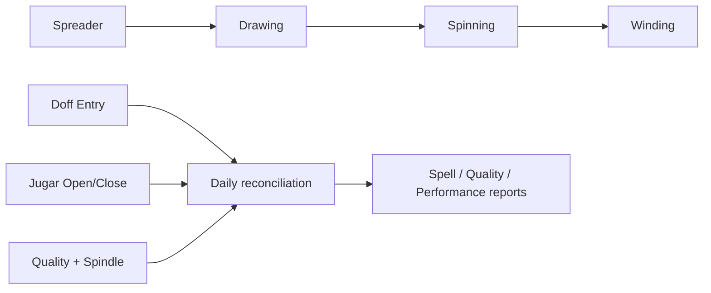

# Jute Production — Winding sub-section Index

Last verified: 2026-06-13

> Scope: documentation-only design for a **new Winding Production** sub-section of the Jute
> Production module (Spreader → Drawing → Spinning → **Winding**). Captures the legacy code3i
> winding logic (Doff / Jugar / Quality), the data points collected, and the formulas — plus a
> proposed vowerp3-native target (tables, endpoints, page). **Not yet implemented.**
> Persona: **Portal** (tenant DB). The existing spreader/drawing/spinning catalog stays inline in
> the `module-jute-production` agent; this folder is the winding-specific knowledge part.

## Document chain

## Cross-repo file registry

| What | Path |
|------|------|
| **Primary design doc (BE)** | `../vowerp3be/docs/winding-production-design.md` — full legacy logic + formulas + target design |
| Legacy views (code3i) | `c:\code\code3i\application\views\admin\winding_doff\winding_doff_data.php`, `winding_jugar_entry.php`, `winding_quality_entry.php` |
| Legacy controllers | `c:\code\code3i\application\controllers\admin\Winding_doff_data.php`, `Winding_quality_entry.php` |
| Legacy model (all SQL) | `c:\code\code3i\application\models\Winding_doff_Model.php` |
| Proposed FE page | `src/app/dashboardportal/juteProduction/winding/page.tsx` (Doff / Jugar / Quality tabs) — **not created yet** |
| Proposed FE masters | `src/app/dashboardportal/juteProduction/masters/windingMachineAttr/` — **not created yet** |
| Proposed FE route constants | `src/utils/api.ts` → `apiRoutesPortalMasters` (`WINDING_*`) — **not added yet** |
| Proposed BE routers | `../vowerp3be/src/juteProduction/winding_entry.py`, `winding_masters.py` — **not created yet** |
| Existing sibling pattern | `juteProduction/spreader/` (3-tab page) and `drawing/` (calc-mirroring) |

## Knowledge parts

| File | Covers |
|------|--------|
| `pages-01-winding-production.md` | Proposed Winding page (Doff/Jugar/Quality tabs) + masters, data points, client formulas |
| `backend-map.md` | Proposed winding router → prefix → endpoints, and legacy → vowerp3 endpoint mapping |

> No `approval-flows.md` — winding has **no approval workflow** (direct CRUD + soft delete),
> consistent with the rest of jute production.
