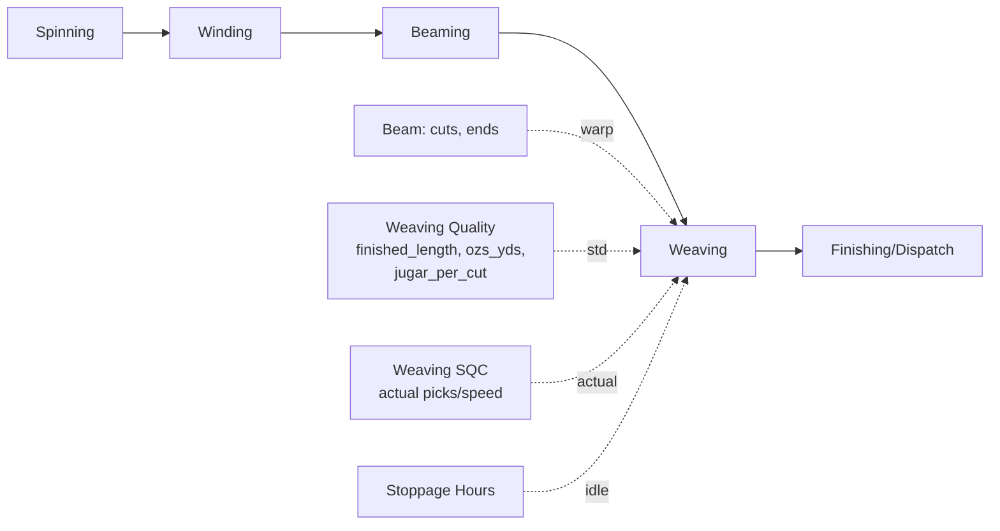

# Jute Production — Weaving (spec / proposed)

Last verified: 2026-06-22 (initial spec — research across vow 2.0 reference + vowerp3 beaming pattern)

> Scope: complete design specification for the **Weaving** section under Jute Production. Weaving is
> the stage **after Beaming**: warp **beams** (built up in *cuts*) are mounted on **looms** and the
> weft is interlaced to produce **jute cloth**, measured per **cut** (a fixed *finished length* of
> cloth) and per **jugar** (a partial/leftover cut carried across shifts). This spec defines **four
> pages**, deliberately mirroring the **already-implemented Beaming module** (`beaming/SPEC.md`) and
> the **Spinning** `spngTargetMap`/planning-grid pattern the user referenced:
>
> 1. **Weaving Quality Master** (`jute_prod_weaving_quality`) — master page; maps each *item* (woven
>    jute cloth) to one-or-many *weaving quality* codes, each carrying the **fixed construction**
>    attributes (`ends, finished_length, ozs_yds, no_of_jugar_per_cut, width, ports, shots, mc_teeth`).
> 2. **Weaving Standards / Targets Map** (`jute_prod_weaving_target_map`) — master page; **clones the
>    `spngTargetMap` / `beamingTargetMap` save pattern** (the data-saving style the user explicitly
>    referenced): an effective-dated, inline-grid editor with a **Type selector (Loom | Quality)**.
>    Quality-linked (`id_type='qid'`, `ref_id=weaving_quality_id`) params = std/target **picks**
>    (PPI), **speed** (picks/min), **eff**. Loom-linked (`id_type='mcid'`, `ref_id=machine_id`) params
>    (optional) = std/target **eff** (loom baseline/target efficiency).
> 3. **Weaving Production Entry** (`jute_prod_weaving_daily`) — daily per-loom/per-quality production
>    entry (date/shift/spell + loom; rows of quality, **cuts**, **jugar**), with a **server-computed
>    planning grid** (production yds, production kg, efficiency) — mirroring the Spinning/Beaming
>    planning grid. Weaving's one extra wrinkle vs beaming is the **jugar open/close carry-forward**
>    across spells `A1→B1→A2→B2→C` (and the day boundary).
> 4. **Weaving SQC** (`juteSQC/weaving`) — new page in the **juteSQC** module; reuses the
>    `/weavingTargetMap` endpoints with **`value_role='actual'`** (params `speed` = actual loom
>    speed, `picks` = actual PPI) to capture the **observed** values that override the standards in
>    the efficiency calc. This is the vowerp3 equivalent of the legacy
>    `tbl_prod_weaving_quality_mapping` date-effective actual-shot/speed override. Works exactly like
>    the Beaming SQC page (reuses the `TargetMapEditor` with `valueRole='actual'`).
>
> **Status: PROPOSED (spec only).** Nothing implemented yet. Persona: **Portal**
> (`Depends(get_tenant_db)` + `get_current_user_with_refresh`, `{"data": …}` responses, soft delete
> via `active = 0`, **no approval workflow**, trigger-based audit — no `created_*`). Register routers
> in `src/main.py` after the beaming routers (`:216`). The **idle/working hours** impact is wired the
> same as beaming — `working_hours = max(0, spell working_hours − Σ jute_prod_stoppage_hours)`.
>
> **Reference sources** (read-only, for formulas/fields): legacy `vow_backend_2.0` (Java/Spring) and
> `vow-ui-2.0` (React). Key legacy files cited inline in §13. Working vowerp3 template: the **beaming**
> module (`beaming/SPEC.md`, `src/juteProduction/beaming_*.py`, `juteProduction/beaming/` FE).

---

## 0. Decisions to lock (this session)

> These mirror beaming's locked-decisions table. Items tagged **RECOMMENDED** are the spec's default
> (faithful to legacy + consistent with beaming); confirm or redline in §12 before implementation.

| # | Decision | Recommended value |
|---|----------|-------------------|
| 1 | **Page set** | **Four pages**, mirroring beaming: Quality Master + Standards/Targets Map + Production Entry + Weaving SQC. |
| 2 | **Production-entry grain** | **Per loom + quality, per spell.** Header = `tran_date, spell_id, machine_id (loom), eb_id?`; each row = `weaving_quality_id, cuts, jugar` (+ optional `beam_no`). `cuts`/`jugar` are the only operator inputs; production/efficiency are **server-computed**. |
| 3 | **Two legacy engines → one table** | Legacy had `WEAVING_PRODUCTION` (day/spell aggregate, Java) **and** `CUTS_JUGAR_BUFF_1` (per-loom 5-spell, native SQL). vowerp3 **consolidates to one** per-loom/quality/spell snapshot `jute_prod_weaving_daily`; shift/day/quality rollups are **derived by query** (SUM), never stored — exactly like `jute_prod_beaming_daily`. |
| 4 | **Quality master content (fixed)** | `jute_prod_weaving_quality` stores `item_id, weaving_quality_code, weaving_quality_name, ends, width, ports, shots, finished_length, ozs_yds, no_of_jugar_per_cut, mc_teeth`. Many qualities per `item_id`. **`no_of_jugar_per_cut` is mandatory** (legacy entity omitted it but the production SQL divides by it — §13 A.1). |
| 5 | **Standards split (target map)** | **Quality-linked (`qid`, `ref_id=weaving_quality_id`):** `speed`(picks/min), `picks`(PPI/actual_shots), `eff` — std; `eff` (+ optional `speed`) — target. **Loom-linked (`mcid`, `ref_id=machine_id`, OPTIONAL):** `eff` — std/target (loom baseline/target efficiency from legacy `MECHINE_MASTER.PROD_EFF/TARGET_EFF`). FE Type selector **Loom | Quality** (mirrors beaming's Machine | Quality). |
| 6 | **Actuals (Weaving SQC)** | The Weaving SQC page captures **`value_role='actual'`** for `speed` (actual loom picks/min) and `picks` (actual PPI), quality-linked (`qid`), effective-dated — reuses `/weavingTargetMap` endpoints (= legacy `tbl_prod_weaving_quality_mapping`). When an actual exists as-of the production date it **overrides** the corresponding standard in the efficiency calc; otherwise the standard is used. |
| 7 | **Jugar carry-forward** | **Implement** the legacy open/close roll-forward (§3, §13 B.5): `open` of a spell = prior spell's `close`; `open_A1` of day N = `close_C` of day N−1 for the same loom. This is weaving's only material divergence from beaming. (Alternative: simplified per-spell production with no carry — see §12 Q3.) |
| 8 | **Working hours** | `working_hours = max(0, spell_mst.working_hours − Σ jute_prod_stoppage_hours[machine,date,spell])` — wired to the Stoppage Hours module exactly like beaming (§3). |
| 9 | **No approval workflow** | Direct CRUD + soft delete (`active=0`); no `status_id`, consistent with all of jute production. |
| 10 | **Target tenant DB** | **dev3** (QA/dev tenant) for all DDL/seed/testing — confirm in §12 Q12. |

### 0.1 Foundations to apply to dev3 (mirrors beaming §0.1)

Before the module tables, three foundations must exist in the target tenant (seed via migrations,
like beaming's `create_beaming_item_type_and_machine_type.sql` + `seed_beaming_menu.sql`):

| Object | Action | Notes |
|--------|--------|-------|
| **Loom machine type** | Confirm/seed `machine_type_mst.machine_type_name = 'Loom'` (legacy looms = `MECHINE_MASTER.machineType in ('S4 Loom','Loom')`). `WEAVING_MACHINE_TYPE_NAME` resolves to its `machine_type_id` at runtime. | **Could not verify in dev3** (DB host firewalled from build sandbox) — confirm the existing loom machine-type name, or seed one as beaming seeded `Beaming`=12. §12 Q1. |
| **Woven-cloth item type** | Weaving qualities key off woven jute-cloth items. **Reuse `item_type_master 'Jute Cloth' = 5`** (already applied for beaming, §beaming 0.1) — the woven product is jute cloth. | `WEAVING_ITEM_TYPE_IDS = (5,)`. Confirm whether woven cloth should be a distinct item type vs share `Jute Cloth` with beaming. §12 Q2. |
| **Menus** | 4 `menu_mst` rows under parent *Jute Production* (`menu_id` 768): Weaving Production, Weaving Quality Master, Weaving Standards; + 1 under the juteSQC parent: Weaving SQC. `role_menu_map` left to tenant admin. Seed via `seed_weaving_menu.sql` + `seed_weaving_sqc_menu.sql` (mirror beaming's). | §11. |

---

## 1. Overview

**Weaving** sits between **beaming** (warp preparation) and **finishing**. A warp **beam** (produced
in beaming, built over a number of *cuts*) is mounted on a **loom**; the loom interlaces weft to
weave **jute cloth**. Output is measured in **cuts** — each cut is a fixed **finished length** of
cloth (yards) defined by the quality. A partial cut left on the loom at shift-end is a **jugar**,
carried forward to the next shift.

Each *item* (a woven jute-cloth item, `item_grp_mst.item_type_id = 5` — **Jute Cloth**) is woven as
one or more **weaving qualities** (`weaving_quality`), a code that encodes the cloth construction and
carries `ends`, `finished_length` (yds/cut), `ozs_yds` (weight/length), `no_of_jugar_per_cut`, etc.
Multiple qualities map to one item.

The four pages form a small pipeline (identical shape to beaming's three masters + SQC):

```
Page A  Weaving Quality Master      item → weaving_quality (+ ends, finished_length,    [reference data]
                                     ozs_yds, no_of_jugar_per_cut, width, ports, shots)
Page B  Weaving Standards/Targets    per-quality std/tgt picks, speed, eff (+ optional   [reference data,
        Map                          per-loom eff) — effective-dated                       spngTargetMap clone]
Page C  Weaving Production Entry      daily: loom + quality + cuts + jugar                 [transaction]
                                     → server computes production yds/kg + efficiency
Page D  Weaving SQC (juteSQC)         daily actual picks/speed per quality                 [actuals capture,
        (value_role='actual')        (overrides standards in efficiency calc)               beamingTargetMap clone]
```

Pages A and B are **masters** (`juteProduction/masters/`); Page C is the **production-entry** page
(`juteProduction/weaving/`); Page D lives in the **juteSQC** module (`juteSQC/weaving/`). This is the
same split as Beaming (`beamingQualityMaster` / `beamingTargetMap` masters, `beaming` entry,
`juteSQC/beaming`).

### Process-chain position



---

## 2. Parameter dictionary & linkage (proposed)

The legacy "Parameters" sheet resolved against this spec's decisions. **Linkage** = where the value
comes from at production time, and the `id_type` (`mcid` = loom, `qid` = quality) each target-map
param keys off.

| Parameter | Source (`id_type`) | Linkage (resolved) |
|-----------|--------------------|--------------------|
| `item_id` | `item_mst` via `item_grp_mst.item_type_id = 5` (**Jute Cloth**) | **entry** (per row, via quality) |
| `weaving_quality` | `jute_prod_weaving_quality` | **entry** (per row); many qualities per item |
| `ends` | `jute_prod_weaving_quality.ends` | **quality-linked** (master column) |
| `finished_length` (yds/cut) | `jute_prod_weaving_quality.finished_length` | **quality-linked** (master column) — core production driver |
| `ozs_yds` (oz/yd) | `jute_prod_weaving_quality.ozs_yds` | **quality-linked** (master column) — core kg driver |
| `no_of_jugar_per_cut` | `jute_prod_weaving_quality.no_of_jugar_per_cut` | **quality-linked** (master column) — jugar→yards divisor (mandatory) |
| `width`, `ports`, `shots`, `mc_teeth` | `jute_prod_weaving_quality.*` | **quality-linked** (master columns; reference/guard, not in core formula) |
| `std_speed` (picks/min) | `jute_prod_weaving_target_map` **`qid`**`/standard/speed` (`ref_id=weaving_quality_id`) | **quality-linked** (std, effective-dated) |
| `tgt_speed` (picks/min) | **`qid`**`/target/speed` (optional) | **quality-linked** (target) |
| `act_speed` (picks/min) | **`qid`**`/actual/speed` — **Weaving SQC** | resolved as-of `tran_date`; **overrides** std when present, else falls back to std |
| `std_picks` (PPI / actual_shots) | **`qid`**`/standard/picks` | **quality-linked** (std) — efficiency denominator driver |
| `act_picks` (PPI) | **`qid`**`/actual/picks` — **Weaving SQC** | resolved as-of `tran_date`; **overrides** std when present (= legacy `tbl_prod_weaving_quality_mapping.actual_shot`) |
| `std_eff` | **`qid`**`/standard/eff` | **quality-linked** (std) |
| `tgt_eff` | **`qid`**`/target/eff` | **quality-linked** (target) |
| `loom_std_eff` / `loom_tgt_eff` | **`mcid`**`/standard/eff`, `mcid/target/eff` (OPTIONAL) | **loom-linked** (legacy `MECHINE_MASTER.PROD_EFF/TARGET_EFF`) — §12 Q5 |
| `shift_hours` | `spell_mst.working_hours` | **spell-linked** |
| `idle_hours` | `Σ jute_prod_stoppage_hours` for (machine, date, spell) | **wired** (Stoppage Hours module); 0 when none |
| `working_hours` | `max(0, shift_hours − idle_hours)` | **derived** (net of stoppage) |
| `oz_to_kg` (constant) | `35.2` (= 16 oz/lb × 2.2 lb/kg) | constant `WEAVING_OZ_TO_KG` |
| `yard_factor` (constant) | `36` (picks→yards conversion in std-prod) | constant `WEAVING_YARD_FACTOR` |
| `date` | entry | **header** |
| `shift` | derived from `spell` (`LEFT(spell_code,1)`) | **derived** |
| `spell` | `spell_mst` (5 weaving spells **A1, B1, A2, B2, C**) | **header** |
| `loom` (`machine_id`) | `machine_mst` where `machine_type = 'Loom'` | **header** |
| `eb_no` | `eb_id` (operator/weaver) | **header** (optional) |
| `beam_no` | entry | **data-entry field** (per row, optional — physical beam mounted) |
| `cuts` | entry | **data-entry field** (per row) — full cuts woven |
| `jugar` | entry | **data-entry field** (per row) — partial cut (carried over) |
| `open` / `close` (jugar balance) | derived (§3) | **computed** (carry-forward across spells/days) |
| `production_yds` | derived (§3) | **computed** |
| `production_kg` / `production_mt` | derived (§3) | **computed** |
| `efficiency` | derived (§3) | **computed** |

---

## 3. Calculations (formulas)

All numeric calc is **server-authoritative** (FE shows previews only via `weavingCalc.ts`, exactly
as Spinning/Beaming). The two canonical formulas come straight from the legacy native SQL (§13 B.3,
B.4); the kg conversion from the legacy Java (§13 B.1). Constants: `OZ_TO_KG = 35.2`,
`YARD_FACTOR = 36`.

Per production row (loom + quality + spell), with standards resolved **as-of `tran_date`**
(quality-linked `qid`; loom-linked `mcid` optional):

```text
# ---- resolved inputs ------------------------------------------------------
finished_length = jute_prod_weaving_quality.finished_length        # yds per full cut (fixed)
ozs_yds         = jute_prod_weaving_quality.ozs_yds                 # ounces per yard (fixed)
jugar_per_cut   = jute_prod_weaving_quality.no_of_jugar_per_cut     # jugars per full cut (fixed, > 0)
std_speed       = qid/standard/speed     # picks/min
std_picks       = qid/standard/picks     # PPI (legacy 'actual_shots')
act_speed       = qid/actual/speed       # Weaving SQC; NULL ⇒ use std_speed
act_picks       = qid/actual/picks       # Weaving SQC; NULL ⇒ use std_picks
eff_speed       = COALESCE(act_speed, std_speed)   # speed used in std-prod denominator (legacy override)
eff_picks       = COALESCE(act_picks, std_picks)   # picks used in std-prod denominator (legacy override)
shift_hours     = spell_mst.working_hours
idle_hours      = Σ jute_prod_stoppage_hours[machine,date,spell]
working_hours   = max(0, shift_hours - idle_hours)

# ---- jugar carry-forward (spell order A1 → B1 → A2 → B2 → C, then day boundary) ----
open_spell      = prior spell's close   (open_A1[day N] = close_C[day N-1] for the same loom; 0 if none)
close_spell     = jugar    if (cuts > 0 OR jugar > 0)   else open_spell

# ---- production (yards) ---------------------------------------------------  (legacy §13 B.3)
production_yds  = cuts  * finished_length
                - open_spell * finished_length / jugar_per_cut
                + jugar      * finished_length / jugar_per_cut
#   = full cuts (yds) - opening partial-jugar (yds) + closing partial-jugar (yds).
#   A 'jugar' is a fractional cut; jugar * FL / jugar_per_cut converts leftover jugars to yards.

# ---- production (kg / MT) -------------------------------------------------  (legacy §13 B.1, B.12)
production_kg   = production_yds * ozs_yds / 35.2        # 35.2 = 16 oz/lb × 2.2 lb/kg
production_mt   = production_kg / 1000

# ---- 100% / standard-possible production (yards) for the spell ------------  (denominator of §13 B.4)
std_prod_yds    = (eff_speed * working_hours * 60) / (36 * eff_picks)
#   eff_speed * working_hours * 60 = total picks the loom could insert this spell;
#   ÷ (36 * eff_picks) converts picks → standard yards.

# ---- efficiency (%) -------------------------------------------------------  (legacy §13 B.4)
efficiency      = production_yds * 100 / std_prod_yds                         # guard std_prod_yds > 0
#   = production_yds * 100 * 36 * eff_picks / (eff_speed * working_hours * 60)

# ---- target production (optional, for the planning grid) ------------------
target_prod_yds = std_prod_yds * tgt_eff / 100          # if a qid/target/eff exists
```

**Rollups (derived by query, never stored):** per spell+quality `SUM(cuts)`, `SUM(production_yds)`,
`SUM(production_kg)`, loom count, and `AVG(efficiency)`; line-wise efficiency = `AVG` of A/B/C spell
effs per `machine_mst.line_number` (legacy §13 B.9/B.10) — implement in `reportQueries.py`, not DB
views.

> **Legacy bugs NOT to replicate** (§13): (a) B2/C production rows used `finished_length_a2` instead
> of their own spell's FL — use **each spell's own** `finished_length`. (b) Group-average efficiency
> used `a + b/2` instead of `(a+b)/2` (Java precedence) — use `(a+b)/2`. (c) Beaming report hardcoded
> an 8-hour shift — vowerp3 uses `working_hours` (net of stoppage) per spell.

---

## 4. Page A — Weaving Quality Master

Master page; same shape as **Beaming Quality Master** (`beamingQualityMaster/page.tsx`,
`beaming_masters.py`). Maps an *item* (woven jute cloth) → one-or-many *weaving qualities*.

### 4.1 Table `jute_prod_weaving_quality` (tenant DB)

| Column | Type | Notes |
|--------|------|-------|
| `weaving_quality_id` | INT PK autoinc | |
| `co_id` | INT NOT NULL, idx | company scope |
| `branch_id` | INT NULL | |
| `item_id` | INT NOT NULL, idx | woven cloth item (`item_grp_mst.item_type_id=5`) |
| `weaving_quality_code` | VARCHAR(50) NOT NULL | join key (legacy `quality_code`) |
| `weaving_quality_name` | VARCHAR(100) | |
| `ends` | INT NOT NULL | warp ends |
| `finished_length` | DECIMAL(12,3) NOT NULL | yds per full cut |
| `ozs_yds` | DECIMAL(10,4) NOT NULL | ounces per yard (weight/length) |
| `no_of_jugar_per_cut` | DECIMAL(10,3) NOT NULL | jugars per full cut (>0) |
| `width` | DECIMAL(10,3) NULL | fabric width |
| `ports` | DECIMAL(10,3) NULL | |
| `shots` | DECIMAL(10,3) NULL | target shots/pick (reference) |
| `mc_teeth` | INT NULL | change-gear teeth |
| `active` | INT NOT NULL default 1 | soft-delete |
| `updated_by` | INT NULL | audit (triggers handle created_*) |
| `updated_date_time` | TIMESTAMP | server default CURRENT_TIMESTAMP |

> Flat (no detail table) — legacy weaving quality is flat. If composite/multi-warp weaving qualities
> are later needed, add `jute_prod_weaving_quality_dtl` mirroring `jute_prod_bm_quality_dtl` (§12 Q6).
> ORM: `JuteProdWeavingQuality` in `src/juteProduction/weaving_models.py` (clone `JuteProdBmQuality`).

### 4.2 Endpoints — `weaving_masters.py`, prefix `/api/weavingMasters` (Portal)

| Method | Path | Purpose |
|--------|------|---------|
| GET | `/weaving_quality_setup` | options: items (cloth), for the create dialog |
| GET | `/weaving_quality_list` | list (filter `co_id`, optional `item_id`/`search`) |
| POST | `/weaving_quality_create` | insert one quality |
| PUT | `/weaving_quality_edit/{id}` | patch |
| DELETE | `/weaving_quality_delete/{id}` | soft-delete (`active=0`) |

### 4.3 Frontend

`juteProduction/masters/weavingQualityMaster/page.tsx` — list + create/edit dialog, **no approval**.
Clone `beamingQualityMaster/page.tsx`. Honors `co_id` from `SidebarContext`. Fields per §4.1
(numeric inputs use the `TextFieldNormal`/`TextFieldReq` validation style of the legacy form, §13).

---

## 5. Page B — Weaving Standards / Targets Map

Master page; **clones `spngTargetMap`/`beamingTargetMap` verbatim** (the save pattern the user
referenced). Effective-dated, inline editable grid; LAST-DATE resolution (MAX `effective_date` ≤
`on_date` among active rows, branch-agnostic). Single EAV-style table; applicable params per
`(id_type, value_role)` defined **in code** via `grid_params_for(...)` — there is **no** separate
parameter-definition table (this is the proven pattern, see beaming/spinning).

### 5.1 Table `jute_prod_weaving_target_map` (tenant DB)

Structurally **identical** to `jute_prod_beaming_target_map` (PK renamed):

| Column | Type | Notes |
|--------|------|-------|
| `weaving_target_map_id` | INT PK autoinc | |
| `co_id` | INT NOT NULL, idx | |
| `branch_id` | INT NULL | stored, **not** used in resolution (branch-agnostic) |
| `effective_date` | DATE NOT NULL | versioning key |
| `ref_id` | INT NOT NULL | `machine_id` (mcid) OR `weaving_quality_id` (qid) |
| `id_type` | VARCHAR(8) | `'mcid'` \| `'qid'` |
| `value_role` | VARCHAR(10) | `'standard'` \| `'target'` \| `'actual'` |
| `param` | VARCHAR(20) | `'speed'`,`'picks'`,`'eff'` |
| `value` | DECIMAL(12,4) NOT NULL default 0 | |
| `active` | INT NOT NULL default 1 | |
| `updated_by` | INT NULL | |
| `updated_date_time` | TIMESTAMP | |

ORM: `JuteProdWeavingTargetMap` in `weaving_models.py` (clone `JuteProdBeamingTargetMap`).

### 5.2 Applicable params (`grid_params_for`, in code — single source of truth)

```python
# weaving_target_map.py  (mirrors beaming_target_map.grid_params_for)
QID:  standard -> ("speed", "picks", "eff")     # quality-linked standards
      target   -> ("eff",)                       # (+ "speed" if Q5b)
      actual   -> ("speed", "picks")             # Weaving SQC page
MCID: standard -> ("eff",)                        # OPTIONAL loom baseline (Q5)
      target   -> ("eff",)
```

### 5.3 Endpoints — `weaving_target_map.py`, prefix `/api/weavingTargetMap` (Portal)

Clone beaming's 7 endpoints verbatim (rename table/PK/ref queries):

| Method | Path | Purpose |
|--------|------|---------|
| GET | `/target_map_setup` | pick-lists: looms (mcid), qualities (qid), id_types, value_roles, params |
| GET | `/target_map_grid` | the editable grid: `params = grid_params_for(id_type,value_role)`, refs × params, LAST-DATE-resolved cells with `is_exact` |
| POST | `/target_map_bulk_save` | upsert/clear cells (exact-key, branch-agnostic, one transaction); returns `{inserted,updated,cleared}` |
| GET | `/target_map_list` | flat list (alt view) |
| POST | `/target_map_create` | single-row insert (with cross-dimension `param ∈ grid_params_for` guard) |
| PUT | `/target_map_edit/{id}` | patch `effective_date/value/active` |
| DELETE | `/target_map_delete/{id}` | soft-delete |

`qid` refs come from `jute_prod_weaving_quality` (code+name); `mcid` refs from `machine_mst` filtered
by `machine_type_name = 'Loom'`.

### 5.4 Frontend

`juteProduction/masters/weavingTargetMap/{page.tsx, _components/TargetMapEditor.tsx,
_components/TargetGrid.tsx}` — copy beaming's three files; change only: (a) editor's two route
constants → `WEAVING_TARGET_MAP_GRID`/`_BULK_SAVE`; (b) `PARAM_LABELS = {speed:"Speed (picks/min)",
picks:"Picks (PPI)", eff:"Efficiency %"}`; (c) `ID_TYPE_LABELS = {mcid:"Loom", qid:"Quality"}`;
(d) page title. `VALUE_ROLE_OPTIONS = ["standard","target"]` (**"actual" excluded — entered on the
SQC page**). Plain TS types, no Zod/RHF (matches the target-map pages).

---

## 6. Page C — Weaving Production Entry

Daily per-loom/per-quality entry with a **server-computed planning grid**. Mirrors **Beaming
Production Entry** (`juteProduction/beaming/`, `beaming_entry.py`) — **server-authoritative** (the
server re-resolves standards and recomputes; client-sent computed columns are ignored on save).

### 6.1 Table `jute_prod_weaving_daily` (tenant DB)

Grain (locked header) = `(co_id, tran_date, spell_id, machine_id, weaving_quality_id, active=1)`.
One flat row per loom+quality+spell; identity + inputs + resolved standards + computed outputs all on
the same row (like `jute_prod_beaming_daily`).

| Group | Columns |
|-------|---------|
| Identity | `weaving_daily_id` PK · `co_id` idx · `branch_id` · `tran_date` idx · `spell_id` idx · `machine_id` idx (loom) · `weaving_quality_id` idx · `eb_id` null · `beam_no` VARCHAR(50) null |
| Inputs | `cuts` INT NOT NULL · `jugar` INT NOT NULL (default 0) |
| Resolved standards | `finished_length` DEC(12,3) · `ozs_yds` DEC(10,4) · `no_of_jugar_per_cut` DEC(10,3) · `std_speed`/`act_speed` DEC(12,4) · `std_picks`/`act_picks` DEC(12,4) · `std_eff`/`target_eff` DEC(6,2) · `working_hours` DEC(5,2) |
| Carry-forward | `open_jugar` INT · `close_jugar` INT |
| Computed | `production_yds` DEC(14,3) · `production_kg` DEC(14,3) · `production_mt` DEC(14,4) · `std_prod_yds` DEC(14,3) · `target_prod_yds` DEC(14,3) · `efficiency` DEC(6,2) |
| Audit | `active` default 1 · `updated_by` · `updated_date_time` |

ORM: `JuteProdWeavingDaily` in `weaving_models.py` (clone `JuteProdBeamingDaily`; add `cuts/jugar/
open_jugar/close_jugar/finished_length/ozs_yds/no_of_jugar_per_cut`).

### 6.2 Endpoints — `weaving_entry.py`, prefix `/api/weavingProd` (Portal)

Mirror beaming_entry.py:

| Method | Path | Purpose |
|--------|------|---------|
| GET | `/entry_create_setup` | looms, spells, eb_list, qualities (with item) |
| GET | `/entries_by_date` | rows for date/spell/loom |
| GET | `/machine_standards` | resolve std/target/actual params + working_hours as-of date for a (loom, quality) |
| POST | `/entry_create` | upsert one loom+quality snapshot (server-computed) |
| PUT | `/entry_edit/{id}` | re-resolve + recompute |
| DELETE | `/entry_delete/{id}` | soft-delete |
| GET | `/planning_grid` | per-loom/quality planning snapshot (resolve + compute, incl. jugar carry-forward) |
| POST | `/planning_grid_save` | batch upsert; **server recomputes** (ignores client computed cols), commit-once |

Inputs (`BeamingEntryCreate`-style Pydantic): `co_id, branch_id?, tran_date, spell_id, machine_id,
eb_id?, weaving_quality_id, beam_no?, cuts (ge 0), jugar (ge 0)`. `finished_length`, `ozs_yds`,
`no_of_jugar_per_cut` resolve from the quality master; `speed`/`picks`/`eff` from the target map (std,
overridden by SQC actual); `working_hours` net of stoppage.

### 6.3 Service `services/weaving_rules.py` + `services/weaving_standards.py`

- `weaving_standards.resolve_quality_standards(db, co_id, weaving_quality_id, on_date)` — LAST-DATE
  resolve `qid` std/target/actual `speed`/`picks`/`eff` (+ optional `mcid` loom eff); clone
  `beaming_standards.resolve_machine_standards`.
- `weaving_rules.compute_weaving_daily(...)` — the §3 formulas incl. **jugar open/close carry-forward**
  (resolve `open_jugar` from the prior spell/day `close_jugar` for the same loom). Clone
  `beaming_rules.compute_beaming_daily`; add the carry-forward resolver (query prior close).

### 6.4 Frontend

`juteProduction/weaving/` — clone the beaming entry page shape:
`page.tsx`, `types/weavingTypes.ts`, `hooks/{useWeavingSetup, useWeavingEntriesByDate,
useWeavingPlanningGrid}.ts`, `_components/{WeavingEntryForm, DailyWeavingGrid, WeavingPlanningGrid}.tsx`,
`utils/weavingCalc.ts` (FE preview of §3, server is authoritative). Header = date + spell + loom
(+ eb); entry form rows = quality + cuts + jugar (+ beam_no); planning grid shows resolved standards +
computed production/efficiency. Honors `co_id`/`branch_id` from `SidebarContext`.

---

## 7. Page D — Weaving SQC (juteSQC module)

New page `src/app/dashboardportal/juteSQC/weaving/page.tsx`. **Reuses the `/weavingTargetMap`
endpoints with `value_role='actual'`** (params `speed` = actual loom picks/min, `picks` = actual PPI),
quality-linked (`qid`), effective-dated — i.e. it reuses the **same `TargetMapEditor`** as Page B but
pinned to `valueRole='actual'` with SQC labels. Exactly like the **Beaming SQC** page
(`juteSQC/beaming/page.tsx`, §beaming 0.2). No new backend — the actuals it writes are resolved
as-of `tran_date` by the production entry (§3 `act_speed`/`act_picks`, overriding the standards). This
is the vowerp3 replacement for legacy `tbl_prod_weaving_quality_mapping` (§13 A.7).

> Menu lives under the juteSQC parent (seed `seed_weaving_sqc_menu.sql`, mirror
> `seed_beaming_sqc_menu.sql`).

---

## 8. Constants (`src/juteProduction/constants.py` additions)

```python
# Weaving (loom) machine type — resolved against machine_type_mst.machine_type_name.
WEAVING_MACHINE_TYPE_NAME = "Loom"          # confirm/seed in dev3 (§0.1, Q1)
WEAVING_ITEM_TYPE_IDS     = (5,)            # 'Jute Cloth' (reuse beaming's; Q2)
WEAVING_OZ_TO_KG          = 35.2            # ounces -> kg (16 oz/lb × 2.2 lb/kg)
WEAVING_YARD_FACTOR       = 36              # picks -> standard-yards conversion
WEAVING_ID_TYPE_MC        = "mcid"
WEAVING_ID_TYPE_QLTY      = "qid"
WEAVING_VALUE_ROLES       = ("standard", "target", "actual")
WEAVING_QID_PARAMS_STD    = ("speed", "picks", "eff")
WEAVING_QID_PARAMS_TARGET = ("eff",)        # (+ "speed" if Q5b)
WEAVING_PARAMS_ACTUAL     = ("speed", "picks")   # Weaving SQC
WEAVING_MC_PARAMS_STD     = ("eff",)        # OPTIONAL loom baseline (Q5)
WEAVING_MC_PARAMS_TARGET  = ("eff",)
# SPELLS already defined: ("A1","A2","B1","B2","C")
```

---

## 9. Backend registration (`src/main.py`)

Add after the beaming routers (`:216`):

```python
from src.juteProduction.weaving_masters    import router as weaving_masters_router
from src.juteProduction.weaving_target_map import router as weaving_target_map_router
from src.juteProduction.weaving_entry      import router as weaving_entry_router

app.include_router(weaving_masters_router,    prefix="/api/weavingMasters",   tags=["jute-weaving-masters"])
app.include_router(weaving_target_map_router, prefix="/api/weavingTargetMap", tags=["jute-weaving-targets"])
app.include_router(weaving_entry_router,      prefix="/api/weavingProd",      tags=["jute-weaving"])
```

New BE files: `weaving_models.py`, `weaving_masters.py`, `weaving_query.py`, `weaving_target_map.py`,
`weaving_target_map_query.py` (or fold into `weaving_query.py`), `weaving_entry.py`,
`services/weaving_standards.py`, `services/weaving_rules.py`. Migrations in `dbqueries/migrations/`:
`create_weaving_tables.sql`, `create_weaving_machine_type.sql` (if seeding Loom),
`seed_weaving_menu.sql`, `seed_weaving_sqc_menu.sql`. Tests in `src/test/`:
`test_weaving_target_map.py`, `test_weaving_entry.py`, `test_weaving_masters.py`,
`test_weaving_rules.py` (formula/jugar-carry coverage).

---

## 10. Frontend route constants (`src/utils/api.ts`)

Add under `apiRoutesPortalMasters` (copy beaming's blocks):

```
# Weaving Quality Master  (/weavingMasters/...)
WEAVING_QUALITY_SETUP, WEAVING_QUALITY_LIST, WEAVING_QUALITY_CREATE, WEAVING_QUALITY_EDIT, WEAVING_QUALITY_DELETE
# Weaving Target Map  (/weavingTargetMap/...)
WEAVING_TARGET_MAP_SETUP, _LIST, _CREATE, _EDIT, _DELETE, _GRID, _BULK_SAVE
# Weaving Production Entry  (/weavingProd/...)
WEAVING_ENTRY_CREATE_SETUP, WEAVING_ENTRIES_BY_DATE, WEAVING_MACHINE_STANDARDS, WEAVING_ENTRY_CREATE,
WEAVING_ENTRY_EDIT, WEAVING_ENTRY_DELETE, WEAVING_PLANNING_GRID, WEAVING_PLANNING_GRID_SAVE
```

The Weaving SQC page reuses `WEAVING_TARGET_MAP_GRID` / `WEAVING_TARGET_MAP_BULK_SAVE`.

---

## 11. Menus (vowconsole3 template + tenant DB)

Mirror beaming's `seed_beaming_menu.sql` / `seed_beaming_sqc_menu.sql`. Add to `portal_menu_mst`
(vowconsole3 template) and `menu_mst` (tenant DB) under parent *Jute Production* (`menu_id` 768) and
the juteSQC parent; map via `role_menu_map` (left to tenant admin). Use the `add-menu` skill.

| Menu | Parent | Page route |
|------|--------|-----------|
| Weaving Quality Master | Jute Production | `juteProduction/masters/weavingQualityMaster` |
| Weaving Standards | Jute Production | `juteProduction/masters/weavingTargetMap` |
| Weaving Production | Jute Production | `juteProduction/weaving` |
| Weaving SQC | juteSQC | `juteSQC/weaving` |

---

## 12. Open questions / decisions to confirm

| # | Question | Spec default (recommended) |
|---|----------|----------------------------|
| Q1 | **Loom machine type** — what is the exact `machine_type_mst.machine_type_name` for looms in dev3? (Couldn't verify — DB firewalled.) | `'Loom'`; seed if absent (mirror beaming `Beaming`=12). |
| Q2 | **Item type for woven cloth** — share `Jute Cloth` (item_type 5) with beaming, or a distinct woven-cloth type? | Reuse `Jute Cloth` (5). |
| Q3 | **Jugar carry-forward** — implement the full open/close roll-forward across spells/days, or simplify (per-spell production only, no carry)? | **Implement carry-forward** (legacy-faithful). |
| Q4 | **Quality master vs reuse beaming quality** — separate `jute_prod_weaving_quality`, or extend `jute_prod_bm_quality`? (Legacy used ONE shared `weaving_quality_master` for both.) | **Separate** `jute_prod_weaving_quality` (different attributes: finished_length, ozs_yds, jugar_per_cut). |
| Q5 | **Loom-linked standards** — include the optional `mcid` eff dimension (loom baseline/target efficiency), or quality-only? | Include `mcid` eff as optional; quality-linked is primary. |
| Q5b | **Target speed** — add `qid/target/speed`, or target only `eff`? | `eff` only (add `speed` if desired). |
| Q6 | **Composite weaving qualities** — any multi-warp/composite weaving qualities needing a `_dtl` table (like beaming)? | No `_dtl` (legacy flat); add later if needed. |
| Q7 | **`beam_no` / `eb_id` on entry** — capture physical beam no and weaver EB per row? | Yes, both optional. |
| Q8 | **Reports** — which weaving reports to build (loom-yards line-wise eff today/30-day, EB-wise eff, single/double loom)? Legacy had several (§13 B.9–B.11). | Phase 2: loom-yards + spell/quality rollup first. |
| Q12 | **Target tenant DB** | **dev3**. |

---

## 13. Legacy reference cross-walk (vow 2.0 → vowerp3)

> Source: `/home/user/vow_backend_2.0` (Java/Spring/JPA) + `/home/user/vow-ui-2.0` (React). No `.sql`
> DDL exists in the legacy repo — entities are the schema truth.

### Legacy tables → vowerp3

| Legacy (vow 2.0) | vowerp3 |
|------------------|---------|
| `WEAVING_QUALITY_MASTER` (`QUALITY_TYPE=1`) — `WeavingQuality.java`; cols `quality_code, quality_name, width, ports, shots, finished_length, ends, speed, ozs_yds, std_ozs_yds, actual_shots, mc_teeth` + **unmapped** `no_of_jugar_per_cut` | split: fixed attrs → `jute_prod_weaving_quality`; `speed/actual_shots(picks)/eff` → `jute_prod_weaving_target_map` (qid) |
| `CUTS_JUGAR_BUFF_1` — per-loom/day, 5 spell groups A1/B1/A2/B2/C (`CutsJugarBuff1.java`); the real production engine | `jute_prod_weaving_daily` (per loom+quality+spell row; rollups by query) |
| `CUTS_JUGAR` — raw cuts/jugar entries (`CutsJugar.java`) | folded into `jute_prod_weaving_daily` inputs (`cuts`,`jugar`) |
| `WEAVING_PRODUCTION` — day/spell aggregate (`WeavingProduction.java`) | derived rollup (report query) — no separate table |
| `DAILY_WEAVING_QUALITIES` — loom→quality/day/spell (`DailyWeavingQualities.java`) | the loom+quality grain on `jute_prod_weaving_daily` |
| `TBL_PROD_WEAVING_QUALITY_MAPPING` — date-effective actual_shot/speed/finished_length (`WeavingQualityMapping.java`) | `jute_prod_weaving_target_map` rows with `value_role='actual'` (Weaving SQC page) |
| `MECHINE_MASTER` looms (`machineType in 'S4 Loom','Loom'`) — `PROD_EFF`,`TARGET_EFF` | `machine_mst` (`machine_type='Loom'`); loom eff → optional `mcid` target-map params |
| `SPELL_MASTER` (`Spells.java`) — `WORKING_HOURS`, spells A1/B1/A2/B2/C | `spell_mst` (already used by beaming/spinning) |
| Efficiency views `VIEW_EB_WISE_DAY/DAILY/MONTHLY_EFFICIENCY`, `VIEW_SINGLE_DOUBLE_LOOM_REPORT` | reimplement in `reportQueries.py` (§12 Q8) |

### Canonical formulas (exact legacy locations)

| Formula | Legacy file:line | §3 mapping |
|---------|------------------|-----------|
| production_kg = (cuts × finished_length × ozs_yds) / 35.2 | `WeavingProductionServiceImpl.java:56` | `production_kg` |
| efficiency = (cuts×FL×100) / ((speed×wh×60)/actual_shots×36) × no_of_loom | `WeavingProductionServiceImpl.java:62` | `efficiency` (per-loom; vowerp3 drops the ×no_of_loom — computed per loom row) |
| production_{spell} = cuts×FL − open×FL/jugar_per_cut + jugar×FL/jugar_per_cut | `CutsJugarBuff1DAO.java:580-589` | `production_yds` ⭐ |
| efficiency_{spell} = round(prod×100 / ((speed×wh×60)/(36×actual_shots)),2) | `CutsJugarBuff1DAO.java:616-625` | `efficiency` ⭐ |
| open/close jugar roll-forward A1→B1→A2→B2→C (+ day boundary) | `CutsJugarBuff1DAO.java:496-540` | `open_spell`/`close_spell` |
| quality attrs pulled into buffer (FL, actual_shots, speed, jugar_per_cut; actual_shots overridden from mapping) | `CutsJugarBuff1DAO.java:371-386` | resolved std + SQC override |
| working_hours/ticket from attendance | `CutsJugarBuff1DAO.java:194-250` | vowerp3: `spell_mst.working_hours` − stoppage |
| line-wise eff (today + 30-day) = avg of A/B/C spell effs by `line_number` | `CutsJugarDAO.java:488`, `LoomYardsReportImpl.java:214-257` | report rollup (§3) |

### Legacy UI screens (vow-ui-2.0) → vowerp3 pages

| Legacy screen | vowerp3 page |
|---------------|--------------|
| `Master/WeavingQualityMaster/` (fields: qualityCode, qualityName, clothWidth, ports, shots, ends, speed, ouncePerYard, mcTeeth, jugarPerCut) | Page A (§4) |
| `JuteProduction/WeavingProduction/` (date, time, spell, quality, noOfLoom, cuts; shows "From Jugar Entry" reference) | Page C (§6) |
| `JuteProduction/CutsAndJugarEntry/` (loom×spell cuts/jugar grid; server-side "Calculate Production & Efficiency") | Page C planning grid (§6) |
| `JuteProduction/BeamingProduction/` (upstream) | already implemented (beaming) |

---

## 14. Implementation checklist (when approved)

**Backend** — clone beaming, rename weaving:
1. Migration `create_weaving_tables.sql` (`jute_prod_weaving_quality`, `jute_prod_weaving_target_map`,
   `jute_prod_weaving_daily`) + `create_weaving_machine_type.sql` (if seeding Loom). Apply to **dev3**
   via pymysql (run-migration skill).
2. `weaving_models.py` (3 ORM classes, clone beaming).
3. `constants.py` additions (§8).
4. `weaving_query.py` (+ target-map query builders) — clone beaming, branch-agnostic LAST-DATE resolve.
5. `weaving_masters.py`, `weaving_target_map.py` (`grid_params_for` §5.2), `weaving_entry.py`.
6. `services/weaving_standards.py`, `services/weaving_rules.py` (incl. jugar carry-forward).
7. Register routers in `main.py` (§9). Tests in `src/test/`.

**Frontend** — clone beaming FE:
8. `api.ts` constants (§10).
9. `juteProduction/masters/weavingQualityMaster/`, `juteProduction/masters/weavingTargetMap/`,
   `juteProduction/weaving/`, `juteSQC/weaving/`.
10. Menus (§11) via `add-menu`.

**Gotchas to preserve:** `no_of_jugar_per_cut` mandatory; jugar carry-forward across spells/days;
target-map is branch-agnostic single EAV table with applicability in `grid_params_for`; production
entry is server-authoritative; SQC writes `value_role='actual'` that override standards as-of date;
do **not** replicate the three legacy bugs (§3 note).
